 
 

<table width= "800" align="center">
<tr>
<td width= "800" valign="top" align="center"></td>
</tr>

<tr>
<td width= "800" valign="top" align="center"><h1 class="page-heading"> <strong>Hanbo Zhang</strong> </h1></td>
</tr>

<tr>
<td width= "800" valign="top" align="center">Research Fellow @ <strong>National University of Singapore</strong></td>
</tr>

<tr>
<td width= "800" valign="top" align="center"><strong>Email</strong>: <a href="mailto:zhanghanbo163@outlook.com">zhanghanbo163@outlook.com</a></td>
</tr>

<tr>
<td width= "800" valign="top" align="center">
<a href="https://scholar.google.com/citations?user=1qfEEwsAAAAJ">Google Scholar</a>|
<a href="https://www.linkedin.com/in/%E7%BF%B0%E5%8D%9A-%E5%BC%A0-2754551a2/">Linked In</a>|
<a href="https://github.com/ZhangHanbo">GitHub</a>
</td>
</tr>

<tr>
<td width= "800" valign="top" align="center" style="font-size: 18px; padding-bottom: 5px; padding-top: 5px;"> Previously: </td>
</tr>

<tr>
<td width= "800" valign="top" align="center">Robotics Researcher @ <strong>ByteDance Research</strong></td>
</tr>

<tr>
<td width= "800" valign="top" align="center">PhD Candidate @ <strong>Xi'an Jiaotong University</strong></td>
</tr>

<tr>
<td width= "800" valign="top" align="center">Visiting PhD Student @ <strong>National University of Singapore</strong></td>
</tr>

<tr>
<td width= "800" valign="top" halign="center" style="padding-top: 25px" >

   
   

  I am currently a Postdoctoral Research Fellow in National University of Singapore working with 
  Prof. <a href="https://www.comp.nus.edu.sg/~dyhsu/">David Hsu</a>. 
  Previously, I spent around 2 years working as a robotics researcher in ByteDance Research, working closely with <a href="https://www.taokong.org/">Tao Kong</a>.
  Before that, I graduated as a PhD in Control Science and Engineering in Xi'an Jiaotong 
  University, Xi’an, China, in 2022, under the supervision of Prof. 
  <a href="http://gr.xjtu.edu.cn/web/zeuslan">Xuguang Lan</a>.

   
   

<strong style="color: red;">We are recruiting interns working on human-robot interaction and uncertainty-aware planning for robotics! Drop me an email if you are interested.</strong>

   
   

  <strong>Research Keywords</strong>: Long-horizon Interactive Manipulation; Human-Robot Interaction; Robot Grasping System 

</td>
</tr>
</table>

 
 

<h1 class="page-heading"> Recent Works </h1>

[<a href="https://scholar.google.com/citations?user=1qfEEwsAAAAJ&hl=zh-CN">Full Publication List</a>]

&dagger; Corresponding Author, * Co-first Author

<!-- Pub split line -->
<table width= "800" >
<tr>
<td width= "160" valign="top">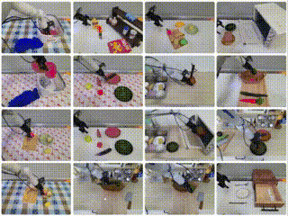</td>
<td width= "640" valign="top"><strong>GR-2: A Generative Video-Language-Action Model with Web-Scale Knowledge for Robot Manipulation</strong>
 
Robotics Research Team, ByteDance Research, Tech. Report, 2024
 

<table width= "100" >
<td width= "50" ><a href="https://arxiv.org/abs/2410.06158">ArXiv</a></td>
<td width= "50" ><a href="https://gr2-manipulation.github.io/">Website</a></td>
<td width= "50" ><a href="https://www.youtube.com/watch?v=FHH0r_QUmyo">Video</a></td>
</table>
</td>
</tr>
</table>

 

<!-- Pub split line -->
<table width= "800" >
<tr>
<td width= "160" valign="top">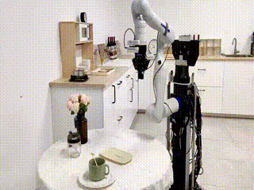</td>
<td width= "640" valign="top"><strong>Towards Unified Interactive Visual Grounding in The Wild</strong>
 
ICRA 2024.
 
Jie Xu, <strong>Hanbo Zhang&dagger; </strong>, Qingyi Si, Yifeng Li, Xuguang Lan, Tao Kong
 

<table width= "100" >
<td width= "50" ><a href="https://arxiv.org/abs/2401.16699">ArXiv</a></td>
<td width= "50" ><a href="https://jxu124.github.io/TiO">Website</a></td>
<td width= "50" ><a href="https://huggingface.co/jxu124/TiO">Code</a></td>
</table>
</td>
</tr>
</table>

 

<!-- Pub split line -->
<table width= "800" >
<tr>
<td width= "160" valign="top">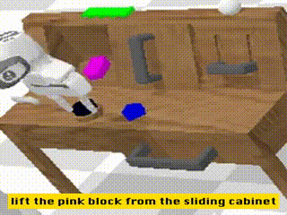</td>
<td width= "640" valign="top"><strong>Vision-Language Foundation Models as Effective Robot Imitators</strong>
 
ICLR 2024.
 
Xinghang Li*, Minghuan Liu*, <strong>Hanbo Zhang</strong>, Cunjun Yu, Jie Xu, Hongtao Wu, Chilam Cheang, Ya Jing, Weinan Zhang, Huaping Liu, Hang Li, Tao Kong
 

<table width= "100" >
<td width= "50" ><a href="https://arxiv.org/abs/2311.01378">ArXiv</a></td>
<td width= "50" ><a href="https://roboflamingo.github.io/">Website</a></td>
<td width= "50" ><a href="https://github.com/RoboFlamingo/RoboFlamingo">Code</a></td>
</table>
</td>
</tr>
</table>

 

<!-- Pub split line -->
<table width= "800" >
<tr>
<td width= "160" valign="top">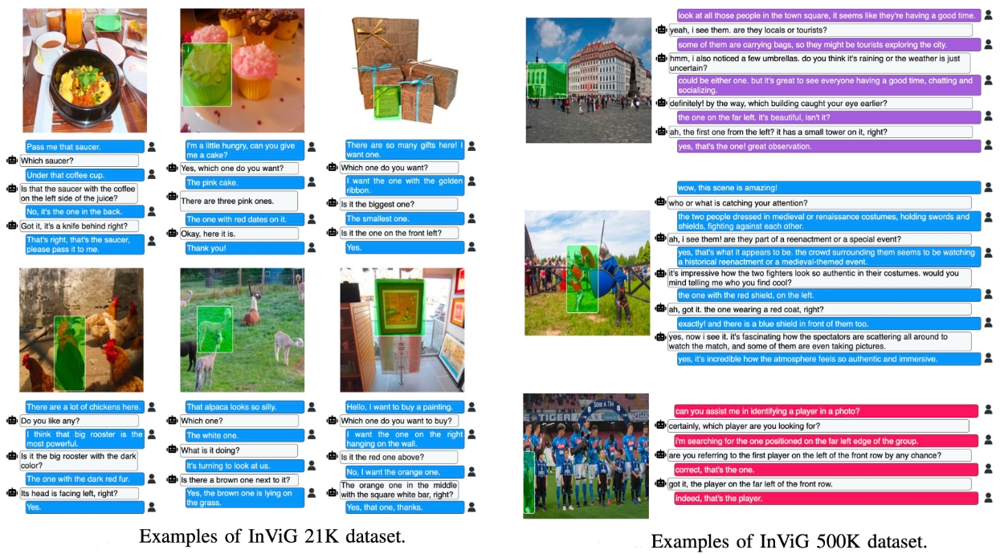</td>
<td width= "640" valign="top"><strong>Invig: Benchmarking interactive visual grounding with 500k human-robot interactions</strong>
 
CVPRW 2024.
 
<strong>Hanbo Zhang*</strong>, Jie Xu*, Yuchen Mo, Tao Kong
 
<table width= "100" >
<td width= "50" ><a href="https://arxiv.org/abs/2310.12147">ArXiv</a></td>
<td width= "50" ><a href="https://openivg.github.io/">Website</a></td>
<td width= "50" ><a href="https://github.com/ZhangHanbo/InViG-Dataset-API">Code</a></td>
<td width= "50" ><a href="https://openivg.github.io/static/paper/invig_files.zip">Data</a></td>
</table>
</td>
</tr>
</table>

 

<!-- Pub split line -->
<table width= "800" >
<tr>
<td width= "160" valign="top">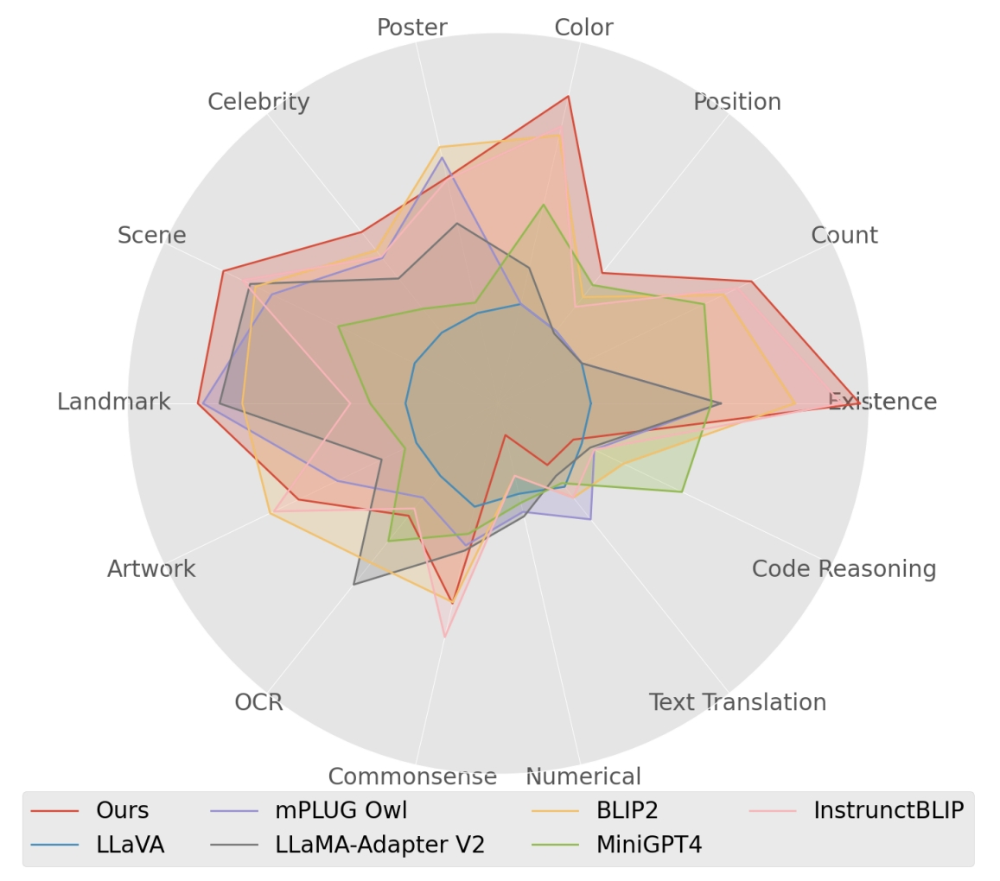</td>
<td width= "640" valign="top"><strong>What matters in training a gpt4-style language model with multimodal inputs?</strong>
 
NAACL 2024.
 
Ranks <a href="https://www.paperdigest.org/2024/09/most-influential-naacl-papers-2024-09/">11th of the most influential papers in NAACL 2024</a>
 
Yan Zeng*, <strong>Hanbo Zhang*</strong>, Jiani Zheng, Jiangnan Xia, Guoqiang Wei, Yang Wei, Yuchen Zhang, Tao Kong
 

<table width= "100" >
<td width= "50" ><a href="https://aclanthology.org/2024.naacl-long.440/">ArXiv</a></td>
<td width= "50" ><a href="https://lynx-llm.github.io/">Website</a></td>
</table>
</td>
</tr>
</table>

 

<!-- Pub split line -->
<table width= "800" >
<tr>
<td width= "160" valign="top">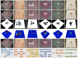</td>
<td width= "640" valign="top"><strong>REGRAD: A Large-Scale Relational Grasp Dataset for Safe and Object-Specific Robotic Grasping in Clutter</strong>
 
RAL with ICRA presentation, 2022.
 
<strong>Hanbo Zhang*</strong>, Deyu Yang*, Han Wang*, Binglei Zhao, Xuguang Lan, Jishiyu Ding, Nanning Zheng
 

<table width= "100" >
<td width= "50" ><a href="https://arxiv.org/abs/2104.14118">ArXiv</a></td>
<td width= "50" ><a href="https://bit.ly/3vCUgQq">Data</a></td>
</table>
</td>
</tr>
</table>

 

<!-- Pub split line -->
<table width= "800" >
<tr>
<td width= "160" valign="top">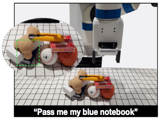</td>
<td width= "640" valign="top"><strong>INVIGORATE: Interactive Visual Grounding and Grasping in Clutter</strong>
 
RSS 2021.
 
<strong>Hanbo Zhang*</strong>, Yunfan Lu*, Cunjun Yu, David Hsu, Xuguang Lan, Nanning Zheng.
 
<table width= "150" >
<td width= "50" ><a href="">ArXiv</a></td>
<td width= "50" ><a href="https://github.com/lyf44/invigorate">Code</a></td>
<td width= "50" ><a href="https://drive.google.com/file/d/1YpuczATq3yA6FHwA7WoSqQNDGpIKzzfU/view">Demo</a></td>
</table>

</td>
</tr>
</table>

 

<!-- Pub split line -->
<!-- <table width= "800" >
<tr>
<td width= "160" valign="top">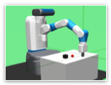</td>
<td width= "640" valign="top"><strong>Hindsight Trust Region Policy Optimization</strong>
 
IJCAI 2021.
 
<strong>Hanbo Zhang</strong>, Site Bai, Xuguang Lan, David Hsu, Nanning Zheng.
 

<table width= "100" >
<td width= "50" ><a href="https://arxiv.org/abs/1907.12439">ArXiv</a></td>
<td width= "50" ><a href="https://github.com/HTRPOCODES/HTRPO-v2">Code</a></td>
</table>

</td>
</tr>
</table>

  -->

<!-- Pub split line -->
<!-- <table width= "800" >
<tr>
<td width= "160" valign="top">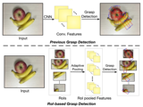</td>
<td width= "640" valign="top"><strong>ROI-based Robotic Grasp Detection in Object Overlapping Scenes</strong>
 
IROS 2019.
 
<strong>Hanbo Zhang</strong>, Xuguang Lan, Site Bai, Xinwen Zhou, Zhiqiang Tian, Nanning Zheng.
 
<table width= "150" >
<td width= "50" valign="top"><a href="https://ieeexplore.ieee.org/abstract/document/8967869">PDF</a></td>
<td width= "50" valign="top"><a href="https://arxiv.org/abs/1808.10313">ArXiv</a></td>
<td width= "50" valign="top"><a href="https://github.com/ZhangHanbo/Visual-Manipulation-Relationship-Network-Pytorch">Code</a></td>
</table>
</td>
</tr>
</table>

  -->

<!-- Pub split line -->
<!-- <table width= "800" >
<tr>
<td width= "160" valign="top" >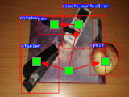</td>
<td width= "640" valign="top"><strong>(Journal)</strong> <strong>Visual Manipulation Relationship Recognition in Object-stacking Scenes</strong>
 
Pattern Recognition Letters, 2020.
 
<strong>Hanbo Zhang</strong>, Xuguang Lan, Xinwen Zhou, Zhiqiang Tian, Yang Zhang, Nanning Zheng
 
<strong>(Conference)</strong> <strong>Visual Manipulation Relationship Network for Autonomous Robotics</strong>
 
Humanoids 2018.
 
<strong>Hanbo Zhang</strong>, Xuguang Lan, Xinwen Zhou, Zhiqiang Tian, Yang Zhang, Nanning Zheng
 
<table width= "200" >
<td width= "50" ><a href="https://www.sciencedirect.com/science/article/abs/pii/S0167865520303445">PDF</a></td>
<td width= "50" ><a href="https://arxiv.org/abs/1802.08857">ArXiv</a></td>
<td width= "50" ><a href="https://github.com/ZhangHanbo/Visual-Manipulation-Relationship-Network-Pytorch">Code</a></td>
<td width= "50" ><a href="https://www.dropbox.com/s/ff0f4bqw4s1pxa2/VMRD%20V2%20fixed.tar.gz?dl=0">Data</a></td>
</table>
</td>
</tr>
</table>

  -->

<!-- Pub split line -->
<!-- <table width= "800" >
<tr>
<td width= "160" valign="top">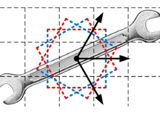</td>
<td width= "640" valign="top"><strong>(Journal)</strong> <strong>A Real-Time Robotic Grasping Approach With Oriented Anchor Box</strong>
 
IEEE Transactions on Systems, Man, and Cybernetics: Systems, 2019.
 
<strong>Hanbo Zhang</strong>, Xinwen Zhou, Xuguang Lan, Jin Li, Zhiqiang Tian, Nanning Zheng.
 
<strong>(Conference)</strong> <strong>Fully Convolutional Grasp Detection Network with Oriented Anchor Box</strong>
 
IROS 2018.
 
Xinwen Zhou, Xuguang Lan, <strong>Hanbo Zhang</strong>, Zhiqiang Tian, Yang Zhang, Narming Zheng
 
<table width= "150" >
<td width= "50" ><a href="https://ieeexplore.ieee.org/abstract/document/8734882">PDF</a></td>
<td width= "50" ><a href="https://arxiv.org/abs/1809.03873">ArXiv</a></td>
<td width= "50" ><a href="https://github.com/ZhangHanbo/Visual-Manipulation-Relationship-Network-Pytorch">Code</a></td>
</table>

</td>
</tr>
</table> -->

<h1 class="page-heading">Mentorship</h1>

<table width="1000" align="center" cellspacing="5">
  <tr>
    <td align="left">
      <a href="https://best99317.github.io/SiteBai/">Site Bai</a>
    </td>
    <td align="left">Ph.D. Candidate</td>
    <td align="left">
      <a href="https://scholar.google.com/citations?user=laOWyTQAAAAJ">Xinghang Li</a>
    </td>
    <td align="left">Ph.D. Candidate</td>
  </tr>
  <tr>
    <td align="left">
      <a href="https://scholar.google.com.hk/citations?user=RPw-LX8AAAAJ&hl=zh-CN">Chengzhong Ma</a>
    </td>
    <td align="left">Ph.D. Candidate</td>
    <td align="left">
      <a href="https://scholar.google.ca/citations?user=s0KcXmgAAAAJ&hl=en">Shiguang Sun</a>
    </td>
    <td align="left">Ph.D. Candidate</td>
  </tr>
  <tr>
    <td align="left">
      <a href="https://www.researchgate.net/scientific-contributions/Han-Wang-2189056994">Han Wang</a>
    </td>
    <td align="left">Ph.D. Candidate</td>
    <td align="left">Jie Xu</td>
    <td align="left">ByteDance, Beijing</td>
  </tr>
  <tr>
    <td width="150" align="left">
      <a href="https://www.researchgate.net/scientific-contributions/Chenjie-Yang-2147422548">Chenjie Yang</a>
    </td>
    <td width="350" align="left">ByteDance, Shanghai</td>
    <td align="left">Deyu Yang</td>
    <td align="left">SenseTime, Shanghai</td>
  </tr>
  <tr>
    <td width="150" align="left">
      <a href="https://scholar.google.com/citations?user=gAY-cIQAAAAJ&hl=zh-CN">Binglei Zhao</a>
    </td>
    <td width="350" align="left">JD, Beijing</td>
  </tr>
</table>
 

<h1 class="page-heading">Professional Activities</h1>

<strong>Journal Reviewer</strong>: IJRR, AURO, RAL, TPAMI, TASE, TNNLS, TSMC
 
<strong>Conference Reviewer</strong>: RSS, ICRA, IROS, AAMAS