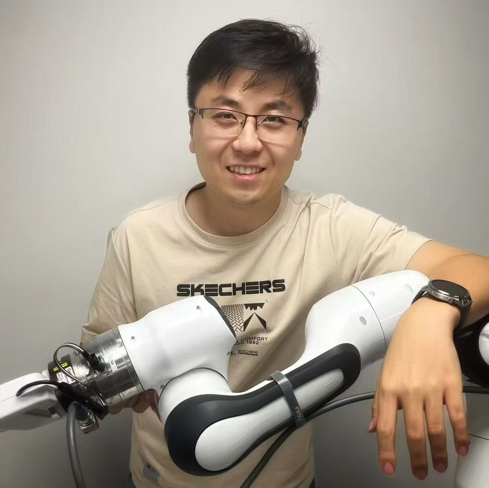

  <a href="javascript:void(0);" onclick="toggleLang()" id="lang-toggle">中文English</a>

<nav class="top-nav" aria-label="Page sections">
  <ul>
    <li><a href="#home">Home主页</a></li>
    <li><a href="#join-us">Join us加入团队</a></li>
    <li><a href="#publications">Publications论文</a></li>
  </ul>
</nav>

  

    <h1 class="name-heading">Hanbo Zhang张翰博</h1>
    
Assistant Professor助理教授

    
<a href="https://www.sii.edu.cn/">Shanghai Innovation Institute</a><a href="https://www.sii.edu.cn/">上海创智学院</a>

    
<strong>Email</strong>:<strong>邮箱</strong>： zhanghanbo <em>at</em> sii <em>dot</em> edu <em>dot</em> cn

    

      <a href="https://scholar.google.com/citations?user=1qfEEwsAAAAJ">Google Scholar</a> &middot;
      <a href="https://www.linkedin.com/in/%E7%BF%B0%E5%8D%9A-%E5%BC%A0-2754551a2/">LinkedIn</a> &middot;
      <a href="https://github.com/ZhangHanbo">GitHub</a>
    

    
<strong>Previously:</strong><strong>过往经历：</strong>

    <ul class="prev-list">
      <li>Senior Research Fellow, <a href="https://adacomp.comp.nus.edu.sg/">AdaComp</a>, <a href="https://www.nus.edu.sg/">National University of Singapore</a> (2024&ndash;2026)高级研究员，<a href="https://adacomp.comp.nus.edu.sg/">AdaComp</a> 实验室，<a href="https://www.nus.edu.sg/">新加坡国立大学</a>（2024&ndash;2026）</li>
      <li>Robotics Researcher, <a href="https://www.bytedance.com/en/">ByteDance Research</a> (2022&ndash;2024)<a href="https://www.bytedance.com/">字节跳动研究院</a> 机器人研究员（2022&ndash;2024）</li>
      <li>Visiting PhD, <a href="https://www.nus.edu.sg/">National University of Singapore</a>访问博士生，<a href="https://www.nus.edu.sg/">新加坡国立大学</a></li>
      <li>PhD, <a href="https://en.xjtu.edu.cn/">Xi'an Jiaotong University</a> (2017&ndash;2022)博士，<a href="https://www.xjtu.edu.cn/">西安交通大学</a>（2017&ndash;2022）</li>
    </ul>
  

  

  
I am an Assistant Professor at the <strong><a href="https://www.sii.edu.cn/">Shanghai Innovation Institute</a></strong>. Before joining <strong>SII</strong>, I was a Senior Research Fellow at the <a href="https://www.nus.edu.sg/">National University of Singapore</a>, working with Prof. <a href="https://www.comp.nus.edu.sg/~dyhsu/">David Hsu</a>; earlier, I was a robotics researcher at <a href="https://www.bytedance.com/en/">ByteDance Research</a> with <a href="https://www.taokong.org/">Tao Kong</a>. I completed my PhD at <a href="https://en.xjtu.edu.cn/">Xi'an Jiaotong University</a> in 2022, advised by Prof. <a href="http://gr.xjtu.edu.cn/web/zeuslan">Xuguang Lan</a>.

  
现任 <strong><a href="https://www.sii.edu.cn/">上海创智学院</a></strong> 助理教授。在此之前，曾在<a href="https://www.nus.edu.sg/">新加坡国立大学</a>（<strong>NUS</strong>）担任高级研究员，与 <a href="https://www.comp.nus.edu.sg/~dyhsu/">David Hsu</a> 教授合作；更早曾在<a href="https://www.bytedance.com/">字节跳动研究院</a>担任机器人研究员，与 <a href="https://www.taokong.org/">Tao Kong</a> 博士合作。2022 年于<a href="https://www.xjtu.edu.cn/">西安交通大学</a>取得博士学位，导师为 <a href="http://gr.xjtu.edu.cn/web/zeuslan">兰旭光</a> 教授。

  
My research studies <strong>structuring uncertainty for open-world manipulation</strong>, developing physically-grounded and reliable intelligence for long-horizon robotic tasks in dynamic environments.

  
我的研究聚焦于 <strong>面向开放世界操纵的不确定性建模</strong>，致力于为动态环境中的长时程机器人任务构建具有物理基础、可靠可信的智能系统。

  
<strong>Open hours for students.</strong> 2 hours every week (20 mins per slot) for a casual chat: research, future plans, brainstorming, honest criticism of me, or anything in your mind. I am open to all of it; just send me an email.<strong>面向学生的开放时间。</strong>每周 2 小时（每位 20 分钟）自由交流：研究、未来规划、头脑风暴、对我的坦诚批评，或任何你心里想聊的话题。我对一切持开放态度，直接发邮件给我即可。

<h1 id="join-us" class="page-heading">Join Our Group加入我们的团队</h1>

Our group launches at <strong><a href="https://www.sii.edu.cn/">Shanghai Innovation Institute</a></strong> in May 2026. We are recruiting <strong>PhD students</strong> for the Fall 2026 or Spring 2027 intake, and <strong>research interns</strong> (remote or in person). We are also hiring a <strong>research engineer</strong>, with a competitive offer for the right candidate.

2026 年 5 月，我们将在 <strong><a href="https://www.sii.edu.cn/">上海创智学院</a></strong> 组建研究组。现招收 <strong>博士生</strong>（2026 秋季或 2027 春季入学），以及 <strong>研究实习生</strong>（线上或线下均可）。同时招聘 <strong>研究工程师</strong>，为合适人选提供具有竞争力的待遇。

<strong>Research topics.</strong> We work on uncertainty-aware task specification and planning, object-centric scene representation for mobile manipulation, and composable, scalable manipulation skills. The broader theme is <em>structuring uncertainty for open-world manipulation</em>.

<strong>研究方向。</strong> 我们聚焦于面向不确定性的任务表达与规划，面向移动操纵的物体中心场景表征，以及可组合、可扩展的操纵技能。整体主题是 <em>为开放世界操纵建模不确定性</em>。

<strong>Who we look for.</strong> Self-motivated, with strong instincts for real-world robotics research: physical robots, contact, planning, mobility, manipulation policies, the parts LLMs cannot do for you. We <strong>ONLY</strong> focus on algorithms and systems that ground in hardware, not conceptually or virtually. Independent thinking that may comfortably disagree with ours is 100% encouraged.

<strong>期望的学生：</strong> 自驱，独立，对真实世界机器人研究有强烈兴趣， 包括但不限于物理机器人、接触动力学、规划、移动性、操作技能学习。我们只关注真正能落到硬件上的算法与系统，而不是局限于概念上的算法创新或仿真。愿意在学术问题上和所有人坦诚讨论甚至辩论。独立思考。

Please fill in this <a href="https://docs.qq.com/form/page/DUE10d0tCVVBkSEpN" style="color: #2053AB; font-weight: 600; text-decoration: none;">Form</a>, and email me your CV, the problem you most want to work on, and one or two representative papers or projects.

请填写 <a href="https://docs.qq.com/form/page/DUE10d0tCVVBkSEpN" style="color: #2053AB; font-weight: 600; text-decoration: none;">该表格</a>，并发送邮件附上你的 CV、最想研究的问题，以及一到两个代表工作或项目。

<h1 class="page-heading">News近期动态</h1>
<ul class="news-list">
  <li><strong>May 2026</strong> &middot; Joining the <a href="https://www.sii.edu.cn/">Shanghai Innovation Institute</a> as an Assistant Professor.<strong>2026 年 5 月</strong> &middot; 加入<a href="https://www.sii.edu.cn/">上海创智学院</a>，出任助理教授。</li>
  <li><strong>Apr 2026</strong> &middot; Hypothesis-driven Model Expansion accepted at <a href="https://roboticsconference.org/">RSS 2026</a>.<strong>2026 年 4 月</strong> &middot; Hypothesis-driven Model Expansion 论文被 <a href="https://roboticsconference.org/">RSS 2026</a> 录用。</li>
  <li><strong>Apr 2026</strong> &middot; Organizing the <a href="https://adacompnus.github.io/human-centric-mobile-manipulation/">Human-centric Mobile Manipulation</a> workshop, accepted to <a href="https://roboticsconference.org/">RSS 2026</a>.<strong>2026 年 4 月</strong> &middot; 组织的 <a href="https://adacompnus.github.io/human-centric-mobile-manipulation/">Human-centric Mobile Manipulation</a> 研讨会入选 <a href="https://roboticsconference.org/">RSS 2026</a>。</li>
  <li><strong>Feb 2026</strong> &middot; <a href="https://robovlms.github.io/">RoboVLMs</a> accepted at <a href="https://www.nature.com/natmachintell/"><em>Nature Machine Intelligence</em></a>.<strong>2026 年 2 月</strong> &middot; <a href="https://robovlms.github.io/">RoboVLMs</a> 论文被 <a href="https://www.nature.com/natmachintell/"><em>Nature Machine Intelligence</em></a> 录用。</li>
  <li><strong>Sep 2025</strong> &middot; <a href="https://github.com/zhangj1an/ApBot">ApBot</a> and <a href="https://sites.google.com/view/mimicfunc">MimicFunc</a> accepted at <a href="https://2025.corl.org/">CoRL 2025</a>; <a href="https://chain-of-action.github.io/">Chain-of-Action</a> accepted at <a href="https://neurips.cc/Conferences/2025">NeurIPS 2025</a>.<strong>2025 年 9 月</strong> &middot; <a href="https://github.com/zhangj1an/ApBot">ApBot</a> 与 <a href="https://sites.google.com/view/mimicfunc">MimicFunc</a> 被 <a href="https://2025.corl.org/">CoRL 2025</a> 录用；<a href="https://chain-of-action.github.io/">Chain-of-Action</a> 被 <a href="https://neurips.cc/Conferences/2025">NeurIPS 2025</a> 录用。</li>
</ul>

  <ul>
    <li><strong>May 2025</strong> &middot; <a href="https://github.com/zhangj1an/ApBot">ApBot</a> paper and code released.<strong>2025 年 5 月</strong> &middot; <a href="https://github.com/zhangj1an/ApBot">ApBot</a> 论文与代码发布。</li>
    <li><strong>Dec 2024</strong> &middot; <a href="https://robovlms.github.io/">RoboVLMs</a> paper and code released.<strong>2024 年 12 月</strong> &middot; <a href="https://robovlms.github.io/">RoboVLMs</a> 论文与代码发布。</li>
    <li><strong>Oct 2024</strong> &middot; <a href="https://gr2-manipulation.github.io/">GR-2</a> technical report released.<strong>2024 年 10 月</strong> &middot; <a href="https://gr2-manipulation.github.io/">GR-2</a> 技术报告发布。</li>
    <li><strong>Jan 2024</strong> &middot; <a href="https://roboflamingo.github.io/">RoboFlamingo</a> accepted at <a href="https://iclr.cc/Conferences/2024">ICLR 2024</a>; <a href="https://jxu124.github.io/TiO">TiO</a> accepted at <a href="https://2024.ieee-icra.org/">ICRA 2024</a>; <a href="https://lynx-llm.github.io/">Lynx</a> accepted at <a href="https://2024.naacl.org/">NAACL 2024</a>.<strong>2024 年 1 月</strong> &middot; <a href="https://roboflamingo.github.io/">RoboFlamingo</a> 被 <a href="https://iclr.cc/Conferences/2024">ICLR 2024</a> 录用；<a href="https://jxu124.github.io/TiO">TiO</a> 被 <a href="https://2024.ieee-icra.org/">ICRA 2024</a> 录用；<a href="https://lynx-llm.github.io/">Lynx</a> 被 <a href="https://2024.naacl.org/">NAACL 2024</a> 录用。</li>
  </ul>

<a href="javascript:void(0);" onclick="toggleNews()" id="news-toggle-btn">[Show More展开更多]</a>



<h1 class="page-heading">Professional Activities学术服务</h1>

  
<strong>Associate Editor</strong><strong>副编辑</strong> &middot; <a href="https://www.ieee-ras.org/publications/ra-l">RA-L</a>

  
<strong>Journal Reviewer</strong><strong>期刊审稿人</strong> &middot; <a href="https://journals.sagepub.com/home/ijr">IJRR</a>, <a href="https://www.ieee-ras.org/publications/t-ro">TRO</a>, <a href="https://www.computer.org/csdl/journal/tp">TPAMI</a>

  
<strong>Conference Reviewer</strong><strong>会议审稿人</strong> &middot; <a href="https://roboticsconference.org/">RSS</a>, <a href="https://corl.org/">CoRL</a>, <a href="https://www.ieee-ras.org/conferences-workshops/fully-sponsored/icra">ICRA</a>, <a href="https://www.ieee-ras.org/conferences-workshops/fully-sponsored/iros">IROS</a>, <a href="https://www.ifaamas.org/">AAMAS</a>

