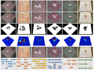
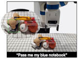
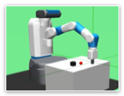
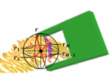
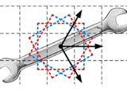

<!-- Pub split line -->
<table width= "800" >
<tr>
<td width= "160" ></td>
<td width= "640" >REGNet: REgion-based Grasp Network for End-to-end Grasp Detection in Point Clouds
 
arXiv preprint arXiv:2104.14118, 2021.
 
<strong>Hanbo Zhang*</strong>, Deyu Yang*, Han Wang*, Binglei Zhao, Xuguang Lan, Jishiyu Ding, Nanning Zheng
 

<table width= "100" >
<td width= "50" ><a href="https://arxiv.org/abs/2104.14118">ArXiv</a></td>
<td width= "50" ><a href="https://bit.ly/3vCUgQq">Data</a></td>
</table>

 
</td>
</tr>
</table>

<!-- Pub split line -->
<table width= "800" >
<tr>
<td width= "160" ></td>
<td width= "640" >INVIGORATE: Interactive Visual Grounding and Grasping in Clutter
 
Robotics: Science and Systems (RSS), 2021.
 
<strong>Hanbo Zhang*</strong>, Yunfan Lu*, Cunjun Yu, David Hsu, Xuguang Lan, Nanning Zheng.
 

<table width= "150" >
<td width= "50" ><a href="">ArXiv</a></td>
<td width= "50" ><a href="https://github.com/lyf44/invigorate">Code</a></td>
<td width= "50" ><a href="https://drive.google.com/file/d/1YpuczATq3yA6FHwA7WoSqQNDGpIKzzfU/view">Demo</a></td>
</table>

 
</td>
</tr>
</table>

<!-- Pub split line -->
<table width= "800" >
<tr>
<td width= "160" ></td>
<td width= "640" >Hindsight Trust Region Policy Optimization
 
International Joint Conference on Artificial Intelligence (IJCAI), 2021.
 
<strong>Hanbo Zhang</strong>, Site Bai, Xuguang Lan, David Hsu, Nanning Zheng.
 

<table width= "100" >
<td width= "50" ><a href="https://arxiv.org/abs/1907.12439">ArXiv</a></td>
<td width= "50" ><a href="https://github.com/HTRPOCODES/HTRPO-v2">Code</a></td>
</table>

 
</td>
</tr>
</table>

<!-- Pub split line -->
<table width= "800" >
<tr>
<td width= "160" ></td>
<td width= "640" >REGNet: REgion-based Grasp Network for End-to-end Grasp Detection in Point Clouds
 
International Conference on Robotics and Automation (ICRA), 2021.
 
Binglei Zhao, <strong>Hanbo Zhang</strong>, Xuguang Lan, Haoyu Wang, Zhiqiang Tian, Nanning Zheng.
 

<table width= "50" >
<td width= "50" ><a href="https://arxiv.org/abs/2002.12647">ArXiv</a></td>
</table>

 
</td>
</tr>
</table>

<!-- Pub split line -->
<table width= "800" >
<tr>
<td width= "160" ></td>
<td width= "640" >A Real-Time Robotic Grasping Approach With Oriented Anchor Box
 
IEEE Transactions on Systems, Man, and Cybernetics: Systems, 2019.
 
<strong>Hanbo Zhang</strong>, Xinwen Zhou, Xuguang Lan, Jin Li, Zhiqiang Tian, Nanning Zheng.
 

<table width= "150" >
<td width= "50" ><a href="https://ieeexplore.ieee.org/abstract/document/8734882">PDF</a></td>
<td width= "50" ><a href="https://arxiv.org/abs/1809.03873">ArXiv</a></td>
<td width= "50" ><a href="https://github.com/ZhangHanbo/Visual-Manipulation-Relationship-Network-Pytorch">Code</a></td>
</table>

 
</td>
</tr>
</table>